# Expiration des certificats du control plane — Reprise après incident sur un cluster Kubernetes

**Auteur :** Aliyou BINATE

Démonstration pratique d'un incident redouté par toute équipe qui opère
un cluster `kubeadm` sur la durée : les certificats internes du control
plane expirent après un an et ne se renouvellent jamais tout seuls. Le
jour où personne n'y a pensé, le cluster entier cesse de répondre — sans
avertissement préalable. Cette étude de cas provoque volontairement cette
panne sur un cluster réel, la diagnostique à partir des seuls symptômes
observables, puis la corrige.

---

## En bref

`kubeadm` émet par défaut des certificats valables **un an**, sans
renouvellement automatique. À l'expiration, toute communication
authentifiée par certificat client au sein du control plane est
refusée — `kubectl`, kubelet, les webhooks d'authentification, tout.
La réparation passe par `kubeadm certs renew all` puis un redémarrage
des pods statiques du control plane pour qu'ils chargent les nouveaux
certificats — **à condition que l'horloge système soit correcte au
moment du renouvellement**, sous peine de recréer le problème dans
l'autre sens (voir "Décisions techniques clés").

---

## Environnement

- Kubernetes v1.32, cluster à 3 nœuds provisionné avec `kubeadm`
  (1 control-plane + 2 workers), CNI Calico, CRI containerd
- Toutes les opérations s'exécutent en SSH, directement sur chaque nœud
  concerné
- **Horloge des 3 nœuds avancée ensemble** (pas seulement celle du
  control-plane) pour simuler "un an s'est écoulé" — une première
  tentative n'avançant que l'horloge du control-plane a produit une
  panne différente et instructive, détaillée plus bas

---

## Le scénario

1. Relever l'état de référence : cluster sain, certificats valides.
2. Avancer l'horloge système des **3 nœuds** au-delà de la date
   d'expiration des certificats.
3. Constater la panne et la diagnostiquer.
4. Corriger via `kubeadm certs renew all` et redémarrer le control
   plane.
5. Vérifier — et découvrir un premier piège secondaire : un
   `~/.kube/config` local resté sur l'ancien certificat.
6. *(suite du 5)* Corriger ce piège, puis découvrir un second piège :
   `kubelet.conf`, propre à chaque nœud, hors du périmètre de
   `kubeadm certs renew`.
7. Régénérer et distribuer `kubelet.conf` sur les 3 nœuds — en
   croisant, sur les workers, un troisième piège (dérive d'horloge via
   `systemd-timesyncd`).
8. Vérification fonctionnelle finale : le cluster répond, et sait
   encore écrire dans etcd.

---

## Étape 1 — État de référence

```bash
kubectl get nodes -o wide
kubectl get pods -n kube-system
sudo kubeadm certs check-expiration
```

**Capture 1**

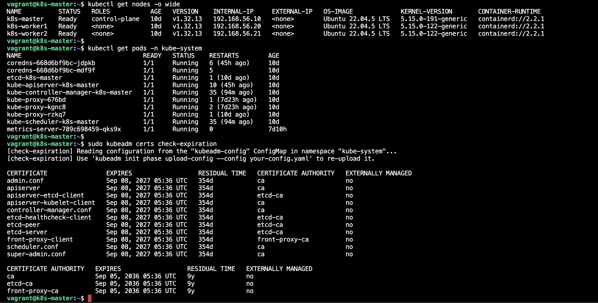

Cluster pleinement opérationnel (3 nœuds `Ready`, tous les pods
`kube-system` `Running`), certificats à 354 jours de leur expiration.

---

## Étape 2 — Provoquer l'expiration

Sur **les 3 nœuds** (pas seulement le control-plane — voir "Décisions
techniques clés" pour pourquoi c'est important) :

```bash
sudo systemctl stop vboxadd-service   # empêche la resynchro auto de l'horloge (spécifique à ce lab VirtualBox)
sudo date -s '2027-09-10 12:00:00 UTC'
```

Aucun redémarrage n'a même été nécessaire pour déclencher la panne :
la toute première commande utilisant une **nouvelle** connexion TLS
échoue immédiatement.

```bash
kubectl get nodes
```

**Capture 2**

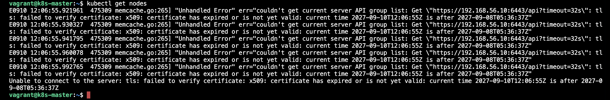

Le message est sans ambiguïté : ce n'est pas une panne réseau, c'est un
rejet de certificat, daté et explicite.

---

## Étape 3 — Diagnostic

```bash
sudo kubeadm certs check-expiration
```

**Capture 3**

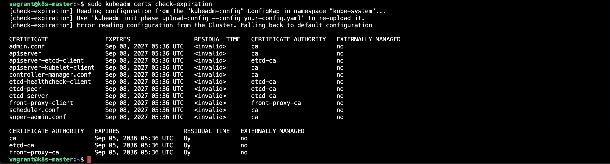

Détail révélateur : `kubeadm` lui-même essaie normalement de lire sa
configuration depuis un `ConfigMap` en cluster — et n'y arrive plus,
pour la même raison que `kubectl`. Il se **rabat silencieusement** sur
la lecture directe des fichiers PKI locaux, ce qui permet quand même
d'obtenir le diagnostic (`<invalid>` au lieu d'un compte à rebours) sans
avoir besoin d'un control plane fonctionnel. Comprendre ce mécanisme de
repli évite de croire, à tort, que `kubeadm certs check-expiration` est
lui aussi hors service.

---

## Étape 4 — Réparation : renouvellement des certificats

```bash
sudo kubeadm certs renew all
```

**Capture 4**

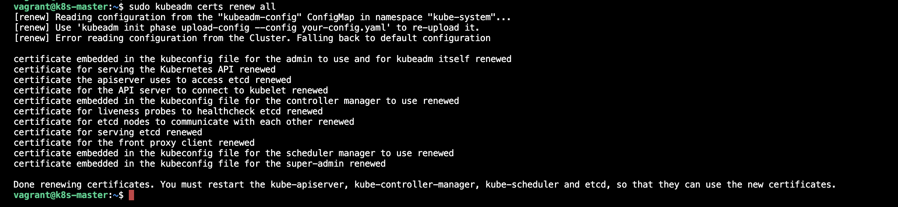

---

## Étape 5 — Redémarrer le control plane avec les certificats renouvelés

Renouveler les fichiers ne suffit pas : les processus du control plane
ont déjà les anciens certificats chargés en mémoire. kubelet ne relit
un pod statique que si son fichier manifeste change (ou disparaît) —
d'où un aller-retour explicite plutôt qu'un simple redémarrage de
service :

```bash
sudo mkdir -p /tmp/manifests-backup
sudo mv /etc/kubernetes/manifests/*.yaml /tmp/manifests-backup/
```

**Capture 4b**

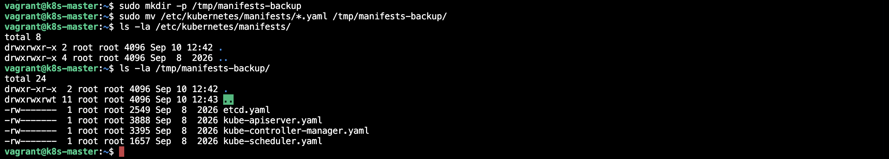

kubelet surveille en permanence le contenu de
`/etc/kubernetes/manifests/` (un simple dossier, pas une API) : dès
qu'un fichier y disparaît, il en déduit que le pod statique
correspondant doit être arrêté. Le dossier vide ici ne signifie pas
"le control plane a planté" — c'est une action volontaire et
réversible, le fichier existe toujours juste à côté, dans
`/tmp/manifests-backup/`.

Vérifier explicitement que les 4 conteneurs ont disparu avant de les
remettre — un premier essai avec un simple délai fixe s'était avéré
insuffisant pour `etcd` (plus lent à s'arrêter proprement que les
autres) :

```bash
sudo crictl ps | grep -E "etcd|kube-apiserver|kube-controller|kube-scheduler"
# répéter jusqu'à ce que la liste soit vide
```

**Capture 4c**

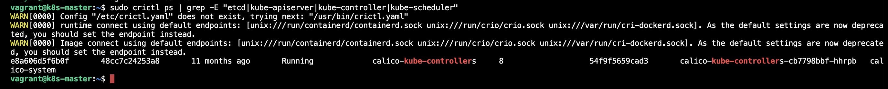

Confirmation avant de remettre les manifestes : les 4 anciens
conteneurs ont bien été tués, pas seulement "en cours d'arrêt". Les
remettre trop tôt (avant cette confirmation) est précisément l'erreur
qui, lors d'un premier essai, avait laissé `etcd` tourner encore avec
son ancien certificat.

```bash
sudo mv /tmp/manifests-backup/*.yaml /etc/kubernetes/manifests/
sleep 20
sudo crictl ps | grep -E "etcd|kube-apiserver|kube-controller|kube-scheduler"
```

**Capture 5**

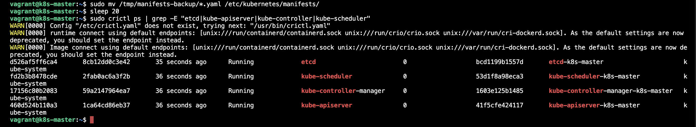

Quatre nouveaux ID de conteneur, démarrés à l'instant — la preuve que
les certificats renouvelés sont bien ceux désormais chargés.

---

## Étape 6 — Le piège secondaire : un `~/.kube/config` périmé

```bash
kubectl get nodes
```

**Capture 6**

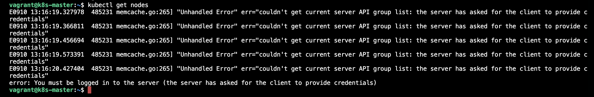

Certificats renouvelés, pods redémarrés — et pourtant `kubectl` échoue
encore, avec un message **différent** de l'erreur x509 initiale. La
cause : `~/.kube/config` est une **copie** de `/etc/kubernetes/admin.conf`
faite une seule fois, au moment du `kubeadm init` d'origine.
`kubeadm certs renew` régénère le fichier canonique sous
`/etc/kubernetes/` — pas les copies qui en ont été tirées ailleurs.

```bash
diff <(sudo grep client-certificate-data /etc/kubernetes/admin.conf) \
     <(grep client-certificate-data ~/.kube/config)
```

**Capture 7**

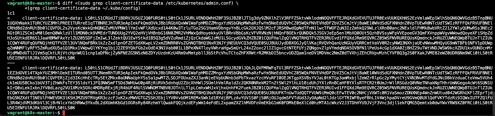

Ce `diff` compare l'unique champ qui compte ici : le certificat client
encodé en base64 dans chacun des deux fichiers. Les deux blocs
affichés sont **différents** — la preuve directe, sans ambiguïté, que
`~/.kube/config` contient toujours l'ancien certificat (celui d'avant
le renouvellement), alors que `/etc/kubernetes/admin.conf` a bien été
mis à jour par `kubeadm certs renew all`. Ce n'est pas une hypothèse :
c'est la donnée elle-même qui le prouve, octet pour octet.

Ce piège dépasse largement ce lab : tout kubeconfig distribué à une
équipe, un pipeline CI ou un outil tiers avant le renouvellement reste
signé avec l'ancien certificat et doit être redistribué — un détail
opérationnel que `kubeadm certs renew all` ne peut pas deviner à votre
place.

---

## Étape 7 — Un troisième piège : `kubelet.conf` n'est pas non plus couvert

`kubectl` fonctionne de nouveau, mais les 3 nœuds passent `NotReady` :

```bash
kubectl get nodes -o wide
```

En cause : `/etc/kubernetes/kubelet.conf` — le kubeconfig que **kubelet
lui-même** utilise pour parler à l'apiserver — a son propre certificat
embarqué, avec la même date d'expiration que tout le reste, mais qui
n'était **pas** dans la liste affichée par `kubeadm certs
check-expiration` à l'étape 1 (relire cette liste : ni `kubelet.conf`,
ni aucun fichier "kubelet" n'y figure). C'est un fichier propre à
**chaque nœud**, généré une seule fois à `kubeadm init`/`kubeadm join`,
hors du périmètre de `kubeadm certs renew`.

```bash
sudo journalctl -u kubelet --no-pager -n 15 | grep -iE "x509|certificate|expired|bootstrap"
```

**Capture 8**

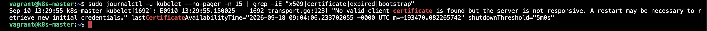

Le message est explicite : *"No valid client certificate is found but
the server is not responsive. A restart may be necessary to retrieve
new initial credentials."* — kubelet a bien détecté le problème, mais
ne peut pas se réparer seul : il lui faudrait un certificat valide pour
en négocier un nouveau, et c'est précisément ce qu'il n'a plus.

### Régénérer `kubelet.conf` sur `k8s-master`

`kubeadm` a une phase dédiée à ça, mais elle refuse d'écraser un
fichier existant si l'URL d'API server qu'elle devine par défaut ne
correspond pas à celle réellement utilisée — il faut donc l'écarter
d'abord et lui fournir la bonne adresse explicitement :

```bash
sudo mv /etc/kubernetes/kubelet.conf /etc/kubernetes/kubelet.conf.expired

cat > /tmp/kubelet-fix-config.yaml <<'EOF'
apiVersion: kubeadm.k8s.io/v1beta4
kind: InitConfiguration
localAPIEndpoint:
  advertiseAddress: 192.168.56.10
  bindPort: 6443
nodeRegistration:
  name: k8s-master
---
apiVersion: kubeadm.k8s.io/v1beta4
kind: ClusterConfiguration
EOF

sudo kubeadm init phase kubeconfig kubelet --config /tmp/kubelet-fix-config.yaml
sudo systemctl restart kubelet
```

**Capture 9**

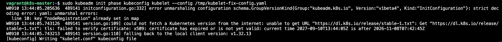

```bash
sudo journalctl -u kubelet --no-pager -n 10 | grep -iE "x509|certificate|error"
kubectl get nodes
```

**Capture 9b**

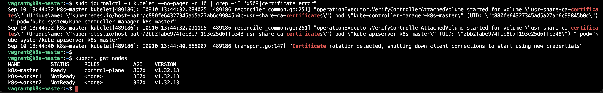

Plus aucune erreur dans les logs — juste une ligne saine,
`"Certificate rotation detected, shutting down client connections to
start using new credentials"` : kubelet a lui-même détecté le nouveau
certificat et rouvert ses connexions avec. `k8s-master` est de nouveau
`Ready`. Les deux workers restent `NotReady` : ils ont exactement le
même problème de `kubelet.conf`, pas encore corrigé.

### Régénérer et distribuer celui des workers

Les workers, eux, n'ont **pas** la clé privée de la CA
(`/etc/kubernetes/pki/ca.key`) — seul le control-plane peut signer un
nouveau certificat. Le `kubelet.conf` d'un worker doit donc être généré
**sur `k8s-master`**, puis transféré. Ce lab n'a pas de confiance SSH
directe entre les VM, mais elles partagent toutes le même dossier
`/vagrant` (monté depuis le Mac) — un relais pratique pour ce transfert
ponctuel.

Sur `k8s-master`, pour `k8s-worker1` :

```bash
mkdir -p /tmp/worker1-kubeconfig

cat > /tmp/kubelet-fix-worker1.yaml <<'EOF'
apiVersion: kubeadm.k8s.io/v1beta4
kind: InitConfiguration
localAPIEndpoint:
  advertiseAddress: 192.168.56.10
  bindPort: 6443
nodeRegistration:
  name: k8s-worker1
---
apiVersion: kubeadm.k8s.io/v1beta4
kind: ClusterConfiguration
EOF

sudo kubeadm init phase kubeconfig kubelet \
  --config /tmp/kubelet-fix-worker1.yaml \
  --kubeconfig-dir /tmp/worker1-kubeconfig

sudo chmod 644 /tmp/worker1-kubeconfig/kubelet.conf
sudo cp /tmp/worker1-kubeconfig/kubelet.conf /vagrant/kubelet-worker1.conf.tmp
```

**Capture 10**

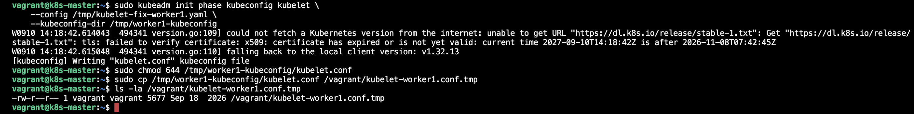

`--kubeconfig-dir` redirige la sortie vers un dossier temporaire plutôt
que d'écraser `/etc/kubernetes/kubelet.conf` de `k8s-master` (qu'on
vient juste de réparer) : `kubeadm` génère ce fichier localement, avec
la clé privée de la CA disponible ici, puis on le dépose dans
`/vagrant` — le seul dossier partagé entre les 3 VM sans confiance SSH
à établir.

Puis, depuis une session SSH séparée sur `k8s-worker1` :

```bash
sudo cp /etc/kubernetes/kubelet.conf /etc/kubernetes/kubelet.conf.expired
sudo cp /vagrant/kubelet-worker1.conf.tmp /etc/kubernetes/kubelet.conf
sudo systemctl restart kubelet
```

### Un piège de plus : la dérive d'horloge des workers

Après ce redémarrage, `k8s-worker1` restait bloqué avec la même erreur
`x509`, mais tournée différemment : *"current time ... is before ..."*
— **avant**, pas après. `systemd-timesyncd` (actif sur les deux
workers, contrairement à `master`) avait profité de l'accès internet
de l'adaptateur NAT pour resynchroniser l'horloge sur l'heure réelle,
dès qu'on avait le dos tourné :

```bash
timedatectl
# System clock synchronized: yes / NTP service: active <- la resynchro silencieuse
```

Correction : désactiver ce second mécanisme de resynchro (en plus de
`vboxadd-service`), puis réaligner l'horloge sur celle — désormais
légèrement plus avancée, le temps réel continuant de s'écouler côté
master — de `k8s-master` :

```bash
sudo timedatectl set-ntp false
sudo systemctl stop systemd-timesyncd
sudo date -s '<heure actuelle de k8s-master, avec un peu de marge>'
sudo systemctl restart kubelet
```

Répété à l'identique pour `k8s-worker2` (génération de son propre
`kubelet.conf` sur master, dépôt via `/vagrant`, application locale,
puis correction de sa propre dérive `systemd-timesyncd`).

**Capture 11**


Les 3 nœuds `Ready`. Deux mécanismes de resynchronisation automatique
de l'horloge (`vboxadd-service` **et** `systemd-timesyncd`) ont dû être
neutralisés sur chaque nœud pour que la simulation tienne assez
longtemps — un détail d'infrastructure de lab, mais qui explique à lui
seul pourquoi une bonne partie de cette démonstration a consisté à
rattraper des horloges qui refusaient de rester où on les avait mises.

---

## Étape 8 — Vérification fonctionnelle finale

```bash
kubectl get pods -A | grep -v Running
```

À ce stade, plusieurs pods applicatifs (ArgoCD, `local-path-provisioner`,
d'anciens objets en `Terminating`) apparaissent en `ImagePullBackOff` ou
bloqués — un effet de bord de la simulation, pas une régression du
control plane : l'horloge encore avancée à 2027 invalide aussi les
certificats TLS **des registres d'images externes** (leurs certificats
réels, eux, expirent bien avant 2027) — toute connexion HTTPS sortante
en souffre également, pas seulement celles vers l'apiserver. Rien à voir
avec `kubeadm` ; ça se résorbera dès le retour à l'heure réelle.

Le test qui prouve réellement que le control plane est opérationnel ne
dépend d'aucune image externe :

```bash
kubectl create ns cert-recovery-verify
kubectl delete ns cert-recovery-verify
```

**Capture 12**


Un test de bout en bout (création **ET** suppression, pas seulement
une lecture) — la preuve que le control plane n'est pas seulement
"joignable" mais pleinement capable d'écrire dans etcd et de faire
aboutir un cycle de vie complet d'objet.

---

## Décisions techniques clés

- **Avancer l'horloge des 3 nœuds ensemble, jamais un seul** — une
  première tentative n'avançant que celle du control-plane a bien
  provoqué la panne, mais a rendu les certificats renouvelés
  **invalides pour les workers** restés à l'heure réelle (leur
  `NotBefore`, ancré au moment du renouvellement, tombait dans leur
  futur). En production, toutes les horloges d'un cluster sont déjà
  synchronisées par NTP — reproduire fidèlement "un an a passé" exige
  donc de faire avancer tout le monde d'un même pas, pas un nœud
  isolément.
- **Ne jamais essayer de revenir à l'heure réelle après un
  renouvellement effectué sous horloge avancée** — les certificats
  renouvelés portent un `NotBefore` fixé à cet instant fictif ; revenir
  ensuite à l'heure réelle les rendrait "pas encore valides". La seule
  sortie propre, une fois la démonstration terminée, est de restaurer
  un snapshot pris avant toute manipulation — jamais de "rattraper"
  l'horloge après coup.
- **Renouveler tous les certificats d'un coup (`renew all`), pas un par
  un** — sur un control plane mono-nœud, `etcd`, `apiserver`,
  `controller-manager` et `scheduler` s'authentifient tous mutuellement
  entre eux ; ne renouveler qu'un seul certificat déplace juste le
  point de rupture au lieu de le résoudre.
- **Redémarrer par déplacement des manifestes, jamais par simple
  `systemctl restart kubelet`** — kubelet ne recharge le contenu TLS
  d'un pod statique que si son manifeste disparaît puis réapparaît. Et
  vérifier **explicitement** (`crictl ps` en boucle) que les anciens
  conteneurs ont bien disparu avant de remettre les manifestes : `etcd`
  met plus de temps que les autres à s'arrêter proprement, et le
  remettre trop tôt annule l'arrêt en cours au lieu de provoquer une
  recréation.
- **`kubeadm certs renew all` ne couvre pas `kubelet.conf`** — le
  kubeconfig que kubelet utilise pour s'authentifier lui-même auprès de
  l'apiserver est un fichier propre à chaque nœud, généré une seule
  fois à `kubeadm init`/`kubeadm join`, absent de la liste de
  `kubeadm certs check-expiration`. Il doit être régénéré séparément
  (`kubeadm init phase kubeconfig kubelet`) — et pour un worker, cette
  régénération ne peut se faire que **sur le control-plane**, seul
  détenteur de la clé privée de la CA.
- **`~/.kube/config` est une copie, pas une référence** — tout
  kubeconfig distribué à une équipe, un pipeline CI ou un outil tiers
  avant le renouvellement reste signé avec l'ancien certificat et doit
  être redistribué manuellement après coup.
- **Neutraliser toute resynchronisation automatique de l'horloge avant
  de commencer** — spécifique à ce lab VirtualBox, mais à vérifier
  systématiquement sur tout environnement de test similaire :
  `vboxadd-service` (Guest Additions) et `systemd-timesyncd` (NTP) sont
  deux mécanismes indépendants, tous deux capables de silencieusement
  annuler un changement d'horloge manuel.

---

## Compétences démontrées

- **Maîtrise opérationnelle de la PKI `kubeadm`** — cycle de vie des
  certificats, diagnostic, renouvellement, mécanique de rechargement
  des pods statiques
- **Diagnostic d'incident à partir des seuls symptômes** — remonter
  d'une erreur `x509` brute jusqu'à la cause racine, sur plusieurs
  couches successives (certificats du control plane, puis
  `~/.kube/config`, puis `kubelet.conf`, puis dérive d'horloge), sans
  connaître la réponse à l'avance
- **Compréhension fine des pods statiques Kubernetes** — pourquoi un
  simple redémarrage de service ne suffit pas à recharger des
  certificats, et pourquoi l'ordre des opérations (vérifier l'arrêt
  avant de relancer) compte
- **Distribution de credentials signés depuis le control-plane** —
  générer un `kubeconfig` pour un autre nœud à partir de la clé privée
  de la CA, que ce nœud ne possède pas lui-même
- **Détection de pièges opérationnels réels et sous-documentés** — le
  `~/.kube/config` périmé et le `kubelet.conf` hors du périmètre de
  `kubeadm certs renew`, deux causes fréquentes d'incidents "le
  renouvellement n'a pas marché" en production
- **Discipline d'expérimentation sûre** — snapshot systématique avant
  toute action destructive sur les 3 nœuds, restauration propre en fin
  de procédure plutôt que de tenter de "réparer" un état devenu
  incohérent

---

## Reproduire cette démonstration

⚠️ Cette procédure casse volontairement le control plane du cluster
ciblé et modifie l'horloge système de ses 3 nœuds. À tester uniquement
sur un cluster de lab/formation, jamais en production, et jamais sans
un snapshot ou une sauvegarde préalable des 3 nœuds.

```bash
git clone <url-de-ce-repo>
cd kubernetes-control-plane-cert-expiry-recovery

# Sur les 3 nœuds (ex. via SSH) :
# suivre les étapes 1 à 8 décrites ci-dessus
```

Nettoyage : restaurer le snapshot pris avant la manipulation de
l'horloge sur les 3 nœuds (`vagrant snapshot restore <vm> <nom>` dans
ce lab), plutôt que d'essayer de remettre les horloges à l'heure
manuellement.

---

## Documentation

- [kubeadm certs — gestion des certificats](https://kubernetes.io/docs/tasks/administer-cluster/kubeadm/kubeadm-certs/)
- [Certificates — PKI Kubernetes](https://kubernetes.io/docs/setup/best-practices/certificates/)
- [Static Pods](https://kubernetes.io/docs/tasks/configure-pod-container/static-pod/)
- [kubelet TLS bootstrapping](https://kubernetes.io/docs/reference/access-authn-authz/kubelet-tls-bootstrapping/)
